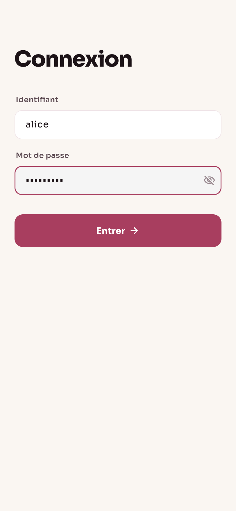
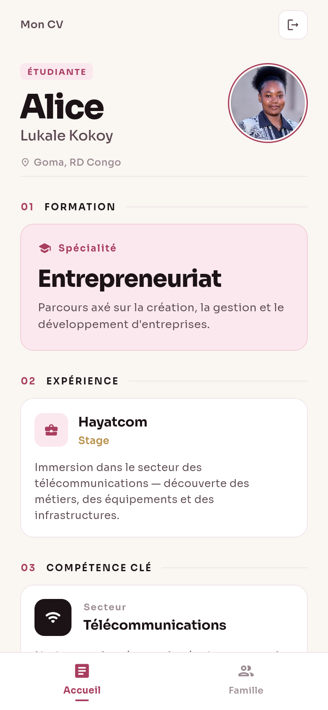
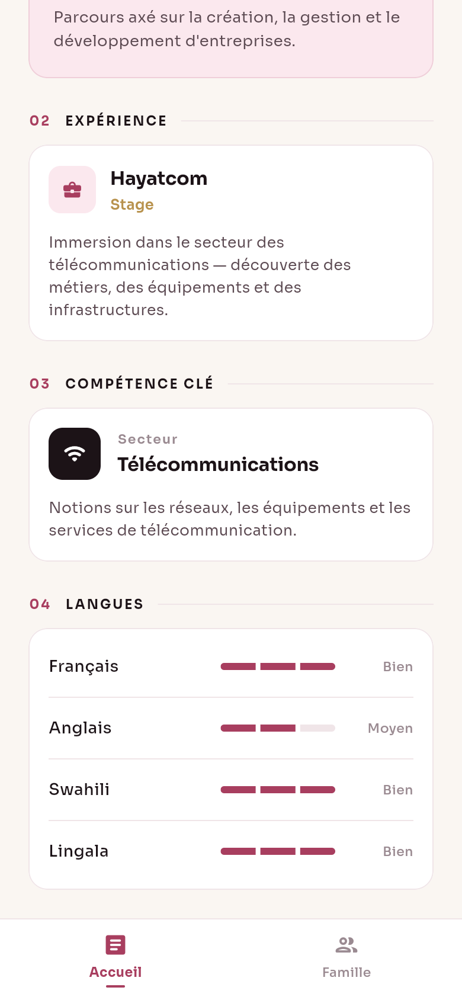
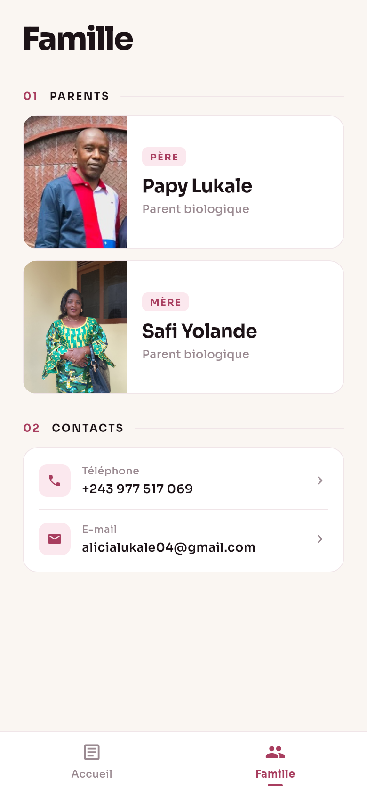

# CV Flutter – Alice Lukale Kokoy

Application mobile Flutter qui présente mon CV, ma famille et mes coordonnées.
L'accès à l'application se fait par une page de connexion.

## Fonctionnalités

- **Connexion** : formulaire avec identifiant, mot de passe masqué (affichable via l'icône œil) et bouton « Entrer ».
- **Accueil (CV)** : photo, nom, titre, formation, expérience, compétence clé et langues avec leur niveau.
- **Famille & contacts** : mes parents avec leur photo, leur nom et leur lien de parenté, ainsi que mes coordonnées (téléphone et e-mail), cliquables grâce à `url_launcher`.
- **Navigation** : une barre de navigation en bas de l'écran (Accueil, Famille) et un bouton de déconnexion.

## Identifiants de test

| Identifiant | Mot de passe |
|-------------|--------------|
| `alice`     | `alice1234`  |

## Captures d'écran

### 1. Page de connexion



### 2. Page d'accueil (CV)

| Profil, formation & expérience | Compétence clé & langues |
|:---:|:---:|
|  |  |

### 3. Page Famille & contacts



## Technologies

- Flutter / Dart (Material 3)
- [`google_fonts`](https://pub.dev/packages/google_fonts) : polices
- [`url_launcher`](https://pub.dev/packages/url_launcher) : appels et e-mails

## Lancer le projet

```bash
flutter pub get
flutter run
```

## Auteur

**Alice Lukale Kokoy** – Étudiante en entrepreneuriat, Goma (RDC)
